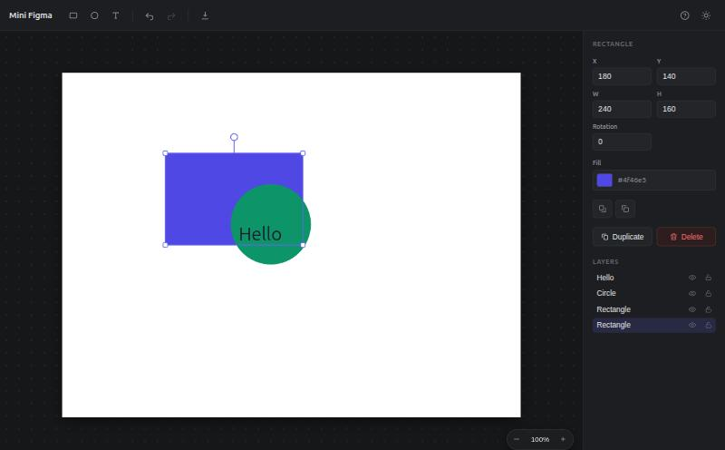
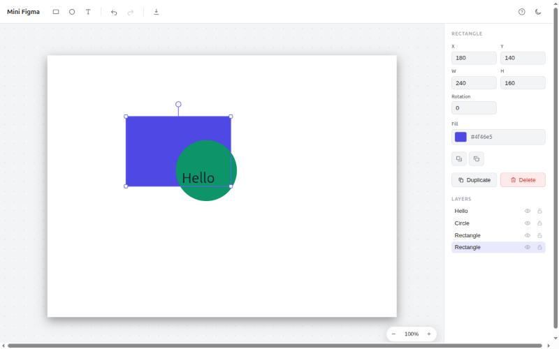

# Mini Figma

A small Figma-like visual editor built with React, TypeScript and an HTML5 canvas. Create rectangles, circles and text, then move, resize and rotate them, tweak their properties, undo/redo your work and export the result as a PNG.

**[Live demo](https://mini-figma-editor.vercel.app)**





## Features

- **Shapes** — add rectangles, circles and text; new shapes animate in.
- **Transform** — drag to move, drag the corner handles to resize, and drag the rotation handle to rotate. Resizing and rotation are rotation-aware, so a rotated shape still scales along its own axes.
- **Text editing** — double-click a text to edit it in place; the box hugs its content, with font size, weight and color controls.
- **Properties panel** — edit the selection's position, size, rotation and fill with live updates. With nothing selected it edits the artboard background.
- **Artboard** — set the canvas width and height or pick a preset (square, 1920×1080, 1280×720, A4); resizing never distorts the shapes.
- **Layers** — a layer list to select, reorder (bring to front / send to back), lock and hide shapes.
- **Zoom & pan** — zoom toward the cursor with `Ctrl`+scroll or the `+`/`-` controls, pan with the wheel or by dragging. Selection and transforms work at any zoom.
- **Undo / redo** — history with per-gesture granularity, from the toolbar or keyboard.
- **Persistence** — the design, artboard size and theme are saved to `localStorage` and restored on reload.
- **Theme** — switch between light and dark; the choice is remembered.
- **Export** — download the artboard as a 2× PNG, always rendered at 100%.

## Keyboard shortcuts

| Action          | Shortcut                                           |
| --------------- | -------------------------------------------------- |
| Edit text       | Double-click a text                                |
| Move selection  | Arrow keys (`Shift` = 10px)                        |
| Duplicate       | `Ctrl/Cmd + D`                                     |
| Delete          | `Delete` or `Backspace`                            |
| Undo            | `Ctrl/Cmd + Z`                                     |
| Redo            | `Ctrl/Cmd + Shift + Z` or `Ctrl + Y`               |
| Zoom to cursor  | `Ctrl/Cmd + scroll`                                |
| Reset zoom      | `Ctrl/Cmd + 0`                                     |
| Pan canvas      | Drag with `Space` held, or the middle mouse button |
| Snap rotation   | Hold `Shift` while rotating (15°)                  |
| Shortcuts panel | `?`                                                |

## Tech stack

- [React 19](https://react.dev/) + [TypeScript](https://www.typescriptlang.org/) in strict mode (no `any`)
- [Vite](https://vite.dev/) for dev server and builds
- [Zustand](https://github.com/pmndrs/zustand) for state management
- HTML5 Canvas 2D for rendering
- [Vitest](https://vitest.dev/) + [React Testing Library](https://testing-library.com/) for tests
- [ESLint](https://eslint.org/) + [Prettier](https://prettier.io/)

## Getting started

Requires [Node.js](https://nodejs.org/) 20 or newer.

```bash
# Install dependencies
npm install

# Start the dev server (http://localhost:5173)
npm run dev
```

### Production build

```bash
npm run build     # type-check and bundle into dist/
npm run preview   # serve the production build locally
```

## Scripts

| Script                 | Description                                    |
| ---------------------- | ---------------------------------------------- |
| `npm run dev`          | Start the Vite dev server with HMR             |
| `npm run build`        | Type-check (`tsc -b`) and build for production |
| `npm run preview`      | Preview the production build                   |
| `npm test`             | Run the test suite in watch mode               |
| `npm run test:run`     | Run the test suite once                        |
| `npm run coverage`     | Run tests with a coverage report               |
| `npm run lint`         | Lint with ESLint                               |
| `npm run format`       | Format the codebase with Prettier              |
| `npm run format:check` | Check formatting without writing               |

## Testing

Tests run on Vitest with a jsdom environment and React Testing Library. They cover the geometry and transform math (including rotated hit-testing and resizing), pan clamping, text measuring, localStorage persistence, the Zustand store (shapes, text editing, layers, canvas size and undo/redo) and the UI components.

```bash
npm run test:run
```

## Project structure

```
src/
├── components/
│   ├── Canvas.tsx            # canvas rendering, view transform and pointer input
│   ├── Toolbar.tsx           # create shapes, undo/redo, export
│   ├── PropertiesPanel.tsx   # shape, artboard and layer controls
│   ├── TextEditor.tsx        # in-place text editing overlay
│   ├── ZoomControls.tsx      # zoom buttons and percentage
│   ├── ShortcutsHelp.tsx     # keyboard shortcuts panel
│   ├── ThemeToggle.tsx       # light/dark toggle
│   └── icons.tsx             # inline SVG icons
├── lib/
│   ├── geometry.ts           # centers, corners, rotation-aware hit testing
│   ├── transform.ts          # resize and rotation math
│   ├── render.ts             # shared shape drawing
│   ├── text.ts               # text measuring / box fitting
│   ├── view.ts               # pan clamping
│   ├── exportPng.ts          # PNG export
│   ├── persistence.ts        # localStorage autosave
│   └── theme.ts              # theme persistence
├── store/
│   └── useEditorStore.ts     # Zustand store with history and view state
├── constants.ts
└── types.ts
```

## How it works

Shapes are plain data in a Zustand store. The canvas redraws the whole scene on every change inside a pan/zoom view transform, applying each shape's rotation around its center. Pointer input is mapped back through the inverse transform into each shape's local, unrotated space, so selection, resizing and rotation behave correctly at any zoom or angle. History snapshots are taken at the start of each gesture, so a single undo reverts a complete move, resize or rotate; the view and editing state stay out of history. The document autosaves to `localStorage` and is restored on load.

## License

MIT
